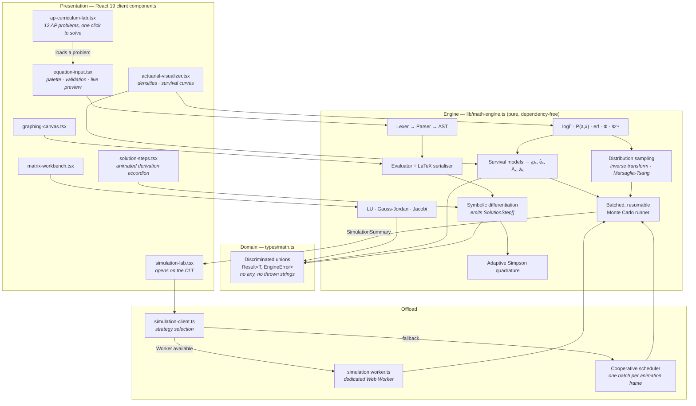
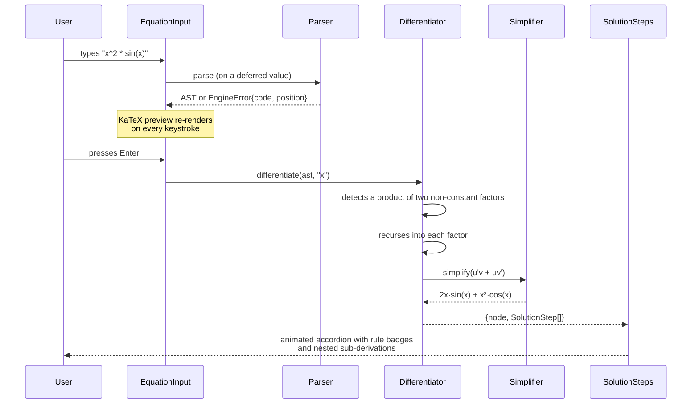

<div align="center">

# MathForge — SAT/AP Calculus Learning Platform

**Step-by-step AP Calculus and Statistics, solved in your browser by an engine written from first principles.**

[](https://nextjs.org)
[](https://www.typescriptlang.org)
[](https://react.dev)
[](https://tailwindcss.com)
[](https://motion.dev)
[](https://katex.org)
[](https://recharts.org)
[](./tests/math-engine.test.ts)
[](./lib/ap-curriculum.ts)
[](./lib/math-engine.ts)

[🚀 **Live demo**](https://mathforge-blush.vercel.app) · [Computation engine](./lib/math-engine.ts) · [Test suite](./tests/math-engine.test.ts) · [FinHub Tracker →](https://github.com/dung037517-netizen/financeflow)

</div>

---

## What this is

A learning platform for **SAT / AP Calculus AB & BC and AP Statistics** that shows the *method*,
not just the answer. Type a function — or pick one of twelve exam-style prompts — and the engine
differentiates or integrates it and prints the complete argument, naming every rule it applies.

It is built with **no computer-algebra library behind it**. The expression parser, the symbolic
differentiator, the adaptive quadrature, the dense linear algebra, the special functions and the
Monte Carlo engine are all implemented from first principles in
[`lib/math-engine.ts`](./lib/math-engine.ts) — strict TypeScript, zero uses of `any`.

That constraint is the point. Anyone can wire up a library; the interesting engineering is in
getting a Lanczos log-gamma to agree with a continued-fraction incomplete gamma to twelve decimal
places, and in proving it with tests that check against closed-form results.

---

## 💡 Actuarial Science & Math Foundation

> **Why a calculus study tool is built on actuarial mathematics.**
>
> Every AP topic in this platform is annotated with the professional technique it becomes. That
> annotation is not decoration — it is the reason the project exists. The mathematics on the AP
> exam *is* the mathematics of risk; the only thing that changes is what the symbols are called.
>
> | AP topic | What it becomes in actuarial practice |
> |---|---|
> | **Chain rule** on $e^{-x^2/2}$ | You have just differentiated the standard normal density — the kernel behind Value at Risk and every option Greek. |
> | **Product rule** on (amount) × (probability) | The sensitivity of a reserve. Every insurance liability is a product of a payout and a chance it happens. |
> | **Quotient rule** | Loss ratios and funded ratios are quotients; their rate of change drives solvency triggers. |
> | **Improper integrals** (BC) | $\int_0^\infty e^{-\delta t}dt = 1/\delta$ is the present value of a perpetuity. Add a survival probability and it becomes $\bar{a}_x$, a life annuity. |
> | **Exponential decay** $e^{-\delta t}$ | The discount factor. Its derivative with respect to time is a bond's duration. |
> | **Area under a curve** | $\int_0^\infty {}_tp_x\,dt$ is the complete expectation of life, $\mathring{e}_x$. |
> | **Normal distribution** (AP Stats) | The 1.96 behind a 95% confidence interval is the same 1.96 inside a parametric VaR. |
> | **Central Limit Theorem** | Why an insurer can price a block of 10,000 policies far more confidently than a single one — risk pooling is the CLT with money attached. |
> | **Expected value** $\int x f(x)\,dx$ | Under a constant force of mortality this integral *is* $\mathring{e}_x = 1/\mu$. |
>
> The platform makes this concrete: the same adaptive Simpson routine that evaluates
> $\int_0^\pi \sin x\,dx = 2$ for an AB student also computes $\bar{A}_x$ for a whole-life policy,
> and the workbench displays $\bar{A}_x + \delta\bar{a}_x$ live — a quantity that must equal exactly
> 1, so any error in the quadrature is visible on screen.

---

## What it does

| | |
|---|---|
| **AP curriculum, worked in full** | Twelve exam-style prompts across Calculus AB, BC and Statistics. Selecting one loads it into the solver and produces a complete derivation — not a lookup table of answers. |
| **Symbolic calculus** | A hand-written recursive-descent parser feeds a differentiator that names every rule it applies — product, quotient, chain, generalised power, and logarithmic differentiation for cases like `x^x`. |
| **AP Statistics simulation** | A Central Limit Theorem laboratory: average a strongly skewed population and watch the sampling distribution become normal, with the simulated spread checked against $\sigma/\sqrt{n}$ on screen. |
| **Dense linear algebra** | LU factorisation with partial pivoting for determinants, Gauss-Jordan for inverses, reduced row echelon form for rank, and cyclic Jacobi rotations for symmetric eigenvalues. |
| **Where the maths leads** | Five parametric mortality laws, with ₜpₓ, e̊ₓ, Āₓ, āₓ and the net premium obtained by adaptive Simpson quadrature over the model's own support. |
| **Non-blocking simulation** | Seeded Monte Carlo running in a Web Worker, with a cooperative main-thread scheduler as a fallback. Neither path can produce a long task. |

---

## Zero cold start

The landing page is fully computed before a reviewer touches anything: a worked product-rule
derivation is on screen at first paint, the graphing canvas is plotted, and the Monte Carlo panel
opens on the Central Limit Theorem. A **🚀 Explore a worked AP problem** button in the hero loads
the flagship problem and scrolls to it in one click.

Measured cold load to network-idle: **~1.1 s**, with 25 KaTeX expressions already typeset.

---

---

## Architecture



### Data flow for a single derivative



---

## Technical highlight: non-blocking client-side math parsing

A Monte Carlo run of 500,000 paths is roughly a second of arithmetic. Done naively that is a
one-second frozen tab — no scrolling, no cursor, no cancel button. MathForge never blocks, through
three separate mechanisms rather than one.

**1. Parsing is interruptible.** The equation editor parses a `useDeferredValue` copy of the input,
not the input itself. React can abandon a stale parse-and-typeset pass when another keystroke
arrives, so typing latency is bounded by the input handler and never by the parser.

```tsx
const deferredValue = React.useDeferredValue(value);
const parsed = React.useMemo(() => parse(deferredValue), [deferredValue]);
```

**2. Simulation is batched and resumable.** The core exposes a `BatchedSimulation` rather than a
blocking `run()`. The caller decides how much work happens before control returns:

```ts
export interface BatchedSimulation {
  readonly totalPaths: number;
  runBatch(size: number): number;      // run up to `size` more paths
  readonly completedPaths: number;
  readonly isComplete: boolean;
  finish(elapsedMs: number): SimulationSummary;
}
```

**3. Execution is offloaded, with an honest fallback.** `runSimulation()` prefers a dedicated Web
Worker. Where a worker cannot be constructed, the *same* batched runner is driven one batch per
animation frame on the main thread — so the longest task is a single batch of a few milliseconds,
and the page still never freezes. The UI reports which strategy actually ran, so the claim is
observable rather than asserted.

Because both paths share `createSimulation()`, results are **bit-for-bit identical for a given
seed** regardless of which strategy executed.

---

## Mathematics implemented

### Calculus

| Rule | Applied when |
|---|---|
| Power, $\frac{d}{dx}x^n = nx^{n-1}$ | exponent free of $x$ |
| Generalised power | base depends on $x$ |
| Product, $(uv)' = u'v + uv'$ | both factors depend on $x$ |
| Quotient, $\left(\tfrac{u}{v}\right)' = \tfrac{u'v - uv'}{v^2}$ | denominator depends on $x$ |
| Chain, $\frac{d}{dx}f(g) = f'(g)\,g'$ | composite functions |
| Logarithmic, $y' = y\left[v'\ln u + \tfrac{v u'}{u}\right]$ | $x$ in **both** base and exponent, e.g. $x^x$ |

Definite integrals use **adaptive Simpson quadrature** with Richardson extrapolation:

$$\int_a^b f\,dx \approx \frac{b-a}{6}\left[f(a) + 4f\!\left(\tfrac{a+b}{2}\right) + f(b)\right]$$

subdividing until the error estimate $|\delta|/15$ falls below tolerance, with a composite
trapezoid fallback for integrands carrying mild singularities.

### Survival models and life contingencies

Five mortality laws, each with a closed-form cumulative hazard:

| Law | Force of mortality $\mu_x$ |
|---|---|
| Exponential | $\mu$ |
| Gompertz | $Bc^{\,x}$ |
| Makeham | $A + Bc^{\,x}$ |
| De Moivre | $\dfrac{1}{\omega - x}$ |
| Weibull | $\dfrac{k}{\lambda}\left(\dfrac{x}{\lambda}\right)^{k-1}$ |

From which the workbench derives:

$$S(x) = e^{-\Lambda(x)}, \qquad {}_tp_x = \frac{S(x+t)}{S(x)}, \qquad \mathring{e}_x = \int_0^\infty {}_tp_x\,dt$$

$$\bar{A}_x = \int_0^\infty e^{-\delta t}\,{}_tp_x\,\mu_{x+t}\,dt, \qquad \bar{a}_x = \int_0^\infty e^{-\delta t}\,{}_tp_x\,dt, \qquad \bar{P}(\bar{A}_x) = \frac{\bar{A}_x}{\bar{a}_x}$$

The UI displays $\bar{A}_x + \delta\bar{a}_x$ live as a **self-check** — it must equal 1, and any
drift would expose a quadrature error immediately.

Monte Carlo sampling of the future lifetime $T_x$ uses inverse transform sampling, which has a
closed form for every law except Makeham — whose mixed linear-plus-exponential hazard is inverted
by bisection on the strictly increasing cumulative hazard.

### Interest theory

Compound accumulation with a full period-by-period schedule, annuity-immediate and annuity-due
present values, cash-flow valuation with Macaulay and modified duration and convexity, and IRR by
bisection — chosen over Newton because a bracketed method on a flat NPV curve cannot diverge.

### Probability

Nine distributions — normal, lognormal, exponential, uniform, gamma, Weibull, binomial, Poisson,
geometric — each with pdf/pmf, CDF, and closed-form moments, built on special functions implemented
here: Lanczos $\ln\Gamma$, regularised incomplete gamma $P(a,x)$ and $Q(a,x)$ by series and
continued fraction, $\mathrm{erf}$ and $\mathrm{erfc}$ derived from them, and the probit function
via Acklam's rational approximation refined by one Halley step.

---

## Testing

Numerical code that isn't pinned against known values is decoration. The suite checks the engine
against results that can be verified independently.

```
✓ 48 tests passing
```

| What is asserted | Against |
|---|---|
| $\mathring{e}_x = 1/\mu$ under a constant force | the analytic identity |
| $\bar{A}_x = \mu/(\mu+\delta)$ and $\bar{a}_x = 1/(\mu+\delta)$ | the analytic identity |
| $\bar{A}_x = 1 - \delta\bar{a}_x$ for **Gompertz** | a law with no closed form for either side |
| De Moivre: ${}_tp_x = \frac{\omega-x-t}{\omega-x}$, $\mathring{e}_{40} = 30$ | the uniform-lifetime result |
| Symbolic derivatives of nine expressions incl. $x^x$, $\tan x$, $\cosh x / x^2$ | central finite differences |
| 40,000 sampled future lifetimes | the analytic ${}_tp_x$, within 1% |
| Monte Carlo EPV of a whole-life block | $\mu/(\mu+\delta)$ |
| GBM terminal mean over 120,000 paths | $S_0e^{\mu T}$ |
| $A\cdot A^{-1} = I$, a $3\times3$ determinant, Jacobi eigenvalues | hand-computed values |
| $\Phi(\Phi^{-1}(p)) = p$ across seven probabilities | round-trip to 1e-10 |
| CLT: simulated spread of sample means | the predicted $\sigma/\sqrt{n}$, within 5% |
| CLT: skewness of the sampling distribution | falls from 2.0 to below 0.5 as $n$ goes 1 → 30 |
| Sampling from all nine distributions | their closed-form mean and variance |
| Identical seeds produce identical results | reproducibility |

```bash
npm test          # vitest run
npm run typecheck # tsc --noEmit
npm run lint      # eslint (flat config)
npm run build     # next build
```

---

## Project structure

```
mathforge/
├── app/
│   ├── layout.tsx              # fonts, metadata, pre-paint theme script
│   ├── page.tsx                # workbench dashboard (server component)
│   └── globals.css             # oklch design tokens, light and dark
├── components/
│   ├── math/
│   │   ├── mathforge-app.tsx   # hero + all sections, owns the demo signal
│   │   ├── ap-curriculum-lab.tsx  # the 12 AP problems
│   │   ├── equation-input.tsx  # palette · validation · KaTeX preview
│   │   ├── actuarial-visualizer.tsx
│   │   ├── solution-steps.tsx  # animated derivation accordion
│   │   ├── graphing-canvas.tsx
│   │   ├── matrix-workbench.tsx
│   │   ├── simulation-lab.tsx
│   │   ├── workbench.tsx
│   │   ├── chart-tooltip.tsx
│   │   └── latex.tsx
│   ├── ui/                     # shadcn-style primitives on Radix
│   └── site/site-header.tsx
├── lib/
│   ├── math-engine.ts          # the whole computation core
│   ├── ap-curriculum.ts        # AP problem set + actuarial links
│   ├── simulation-client.ts    # worker / main-thread strategy selection
│   ├── workers/simulation.worker.ts
│   ├── theme.ts                # useSyncExternalStore theme store
│   └── utils.ts
├── types/math.ts               # the entire domain vocabulary
└── tests/math-engine.test.ts
```

---

## Engineering decisions worth defending

**`Result<T, EngineError>` rather than exceptions.** A malformed expression is an expected outcome
of a text input, not an exceptional one. Every fallible engine function returns a discriminated
union carrying a code, a message, and a character offset — which is why the editor can render a
caret under the exact offending character instead of a generic "invalid input".

**State derived during render, never in an effect.** Resetting the accordion when a new solution
arrives, and clamping the distribution threshold when the family changes, are both done by adjusting
state during render. An effect would produce a frame where the UI shows the previous derivation's
open panels, or a threshold outside the new support.

**`useSyncExternalStore` for the theme.** `data-theme` on the document element is the single source
of truth; React subscribes to it rather than mirroring it, so the toggle can never disagree with
what is painted. An inline pre-paint script applies a stored preference before hydration.

**Discontinuity detection in the plotter.** `samplePlot` emits `null` at poles rather than a large
number, so the renderer breaks the line instead of drawing a false vertical asymptote through
$\tan x$.

**Accessibility is structural.** Every disclosure is a real `aria-expanded` button, every slider
carries an accessible name, charts have `aria-label` descriptions, colour is never the sole carrier
of meaning, and `prefers-reduced-motion` disables the animations.

---

## Running locally

```bash
git clone https://github.com/dung037517-netizen/mathforge.git
cd mathforge
npm install
npm run dev      # http://localhost:3000
```

Requires Node.js 20 or newer.

---

## Related work

**[FinHub Tracker →](https://github.com/dung037517-netizen/financeflow)** — the same engineering
approach applied to portfolio risk: Value at Risk by four estimation methods, Black-Scholes with a
full Greek surface, and a streaming market feed.

<div align="center">
<sub>Built with Next.js, TypeScript, and a math engine written from first principles.</sub>
</div>
